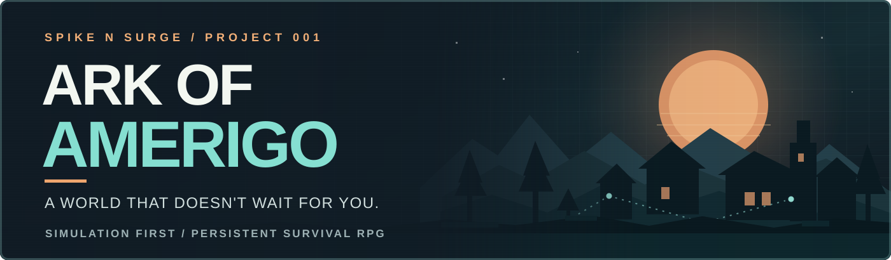

  

<strong>SPIKE N SURGE · IN DEVELOPMENT · QA &amp; REGRESSION TESTING · AI-ASSISTED SDLC / STLC</strong>

# Ark of Amerigo | Building a Living World, Testing Every Step

**Ark of Amerigo** is an original, simulation-first survival RPG set in a post-collapse, alternate-history Amerigo. The idea is to build a persistent world where people have their own knowledge, needs, relationships, ambitions, and choices. A settlement should be able to change even when the player is somewhere else.

I lead the design, project planning, quality strategy, Jira work management, and acceptance reviews under the **Spike N Surge** studio name, with collaborator input and a single inline AI coding agent helping implement and test the systems. We are building the underlying simulation first and leaving graphical gameplay until the text-based experience has been proven.

This is an active, long-term development project, **not a finished or released game**. It has real accepted simulation systems and executable QA evidence, but the complete human-playable text RPG is still a milestone ahead of us.

## At a glance

| Area | Status / evidence |
|---|---|
| Project | Original survival RPG, actively developed |
| Platform / code | Unity 6.3, C#, headless-first simulation |
| Automated tests | NUnit and Unity EditMode |
| Data and persistence | SQLite, migrations, save/restore and deterministic continuation |
| Work management | Jira Cloud for tickets, dependencies, and acceptance |
| Collaboration | ChatGPT-assisted design and review; one inline Codex coding agent |
| **Latest verified full regression** | **7,020 / 7,020 passing Unity EditMode tests**, November 5, 2026 |
| **Persistence regression** | **1,616 / 1,616 passing**, in the same accepted checkpoint |
| **Independent restore proof** | **91 worlds**, written and restored by separate completed processes |
| First playable text RPG | Integration and independent acceptance still pending |
| Continuous integration | Local automated acceptance evidence exists; GitHub Actions CI is **not** yet configured for the game |

*These are dated verification results from the accepted Decision & Autonomy V3 implementation, not a claim that all planned gameplay exists or that a new CI run has occurred.*

## What I do on the project

My involvement spans the **software development life cycle (SDLC)** and the **software testing life cycle (STLC)**. I turn ideas into scoped requirements, decide how features should fit existing systems, build the Jira roadmap, review implementation plans, define acceptance checks, interpret test evidence, and help coordinate fixes.

I use AI as a development partner, but it does not make the final product decisions. The coding agent can implement a design, run tests, and fix failures. I own the requirements, priorities, architecture decisions, quality expectations, and whether the result is acceptable.

One of the most useful lessons has been learning to ask: **What else could this change break?** A game with multiple interacting systems is an ideal place to make that question part of the daily workflow.

## QA and test strategy

| Practice | How I use it |
|---|---|
| **Requirements traceability** | Connect requirements and accepted design contracts to Jira issues, dependencies, and measurable acceptance criteria |
| **Regression testing** | Keep previously accepted behavior under test while adding new features, with focused and full Unity EditMode gates |
| **System integration testing** | Check that separate owners, including Health, Inventory, Work, Government, Decision, and Persistence, still interact correctly |
| **Boundary and negative tests** | Cover duplicate or invalid actions, stale authority, missing information, race conditions, rollback, migration faults, and corruption |
| **Save and restore testing** | Verify snapshots, SQLite versioning, historical compatibility, and continuation after a fresh process loads the world |
| **Deterministic replay** | Check that the same legitimate state and controlled randomness produce compatible results after restoration |
| **Defect investigation** | Preserve failing evidence, identify the actual owner of a defect, repair it, rerun focused cases, and then check broader regression |
| **Acceptance and release control** | Require exact-source test evidence, integration review, Jira closure, and branch cleanup after safe merging |

### What cross-system testing looks like

When an NPC chooses whether to seek office, a successful test means more than receiving a believable sentence. The person must have the right information, make an independent decision, obtain the right authorization from Government, and produce a valid result. That choice must not grant fake authority, accidentally alter unrelated systems, or change after the world is saved and restored.

Because this is a simulation, a bug can cross several system boundaries before anyone notices it. The QA process is built around catching those problems early and demonstrating that the repair did not create a new regression.

## Our AI + Jira + GitHub workflow

We designed a workflow that makes a one-person-led development effort manageable without treating speed as a substitute for quality.

1. **Define:** I set the feature goals, expected behavior, limitations, and questions that must be answered.
2. **Reconcile:** We compare the plan against the actual repository and neighboring systems, then challenge it through repeated fresh-eye reviews.
3. **Track:** Jira holds the work, dependencies, blockers, and acceptance obligations. GitHub holds source, review history, system contracts, and verification records.
4. **Implement:** One inline Codex agent works in an isolated feature workspace, following the agreed design and implementation plan.
5. **Test and repair:** We use source-backed preflight checks, focused tests, regression runs, and special persistence/replay gates as appropriate. Repairable failures are fixed and retested.
6. **Accept and integrate:** We verify the exact tested source, update documentation and Jira, integrate accepted work to `main`, and safely remove merged feature branches.

ChatGPT helps with architectural analysis, Jira reconciliation, reviews, and handoffs. The inline coding agent implements and verifies the plan. **I remain responsible for human decisions and QA acceptance.** It is a collaborative workflow, not a claim that one person manually authored every line of game code.

## A verified milestone: Decision & Autonomy V3

The **November 5, 2026** accepted Decision V3 implementation is a concrete example of the process. It introduced independent NPC civic decisions and real Government handoffs while preserving earlier system behavior.

- **7,020 / 7,020** full Unity EditMode tests passed, with zero skips or inconclusive cases.
- **1,616 / 1,616** Persistence cases passed within that accepted test checkpoint.
- **91 worlds** passed independent writer/reader cold continuation checks, including database integrity and matching future outcomes.
- Actual regression failures were recorded and repaired, then all affected tests and the full suite were rerun.
- GitHub `main` integration, Jira Done status, and safe feature-branch cleanup were verified after acceptance.

These results are backed by internal test manifests and acceptance documentation. They reflect the specific approved source at that checkpoint, not a universal pass for every unfinished game feature.

## Tools and environment

| Function | Tools / practices |
|---|---|
| Simulation development | Unity 6.3, C# |
| Test automation | NUnit, Unity Test Framework / EditMode |
| Data verification | SQLite, snapshot and migration checks, cold-process restore testing |
| Project / test management | Jira Cloud, requirement and defect tracking, acceptance gates |
| Source control | Git, GitHub, feature branches, review, controlled integration |
| AI collaboration | ChatGPT-assisted architecture / QA planning and inline Codex implementation |
| Evidence | Test manifests, source hashes, failure and retest records, acceptance summaries |

## Next milestone and project limits

The next major goal is a real, independently usable **text-based RPG** where players and NPCs can interact with a persistent world through the implemented simulation. Several of the required daily-life, society, perception, and world systems remain in design or development. **SNSNG-73** is the integrated assembly gate, followed by **SNSNG-74** for independent human-playable acceptance. Graphical gameplay is planned later.

The game development repository is private. This public portfolio entry summarizes what I do, how the QA process works, and verified historical results **without publishing game source code or internal Jira material**.

## Why it matters for my QA career

Ark of Amerigo has let me practice quality work every day, from writing testable requirements to deciding whether a complex feature is safe to integrate. It pushes me to investigate failures carefully, communicate clearly, think about the entire product, and keep trustworthy regression evidence.

Those are the same habits I want to bring to a professional QA Analyst role.

---

[**Return to QA Portfolio**](../README.md) · Ark of Amerigo / Spike N Surge · In active development
